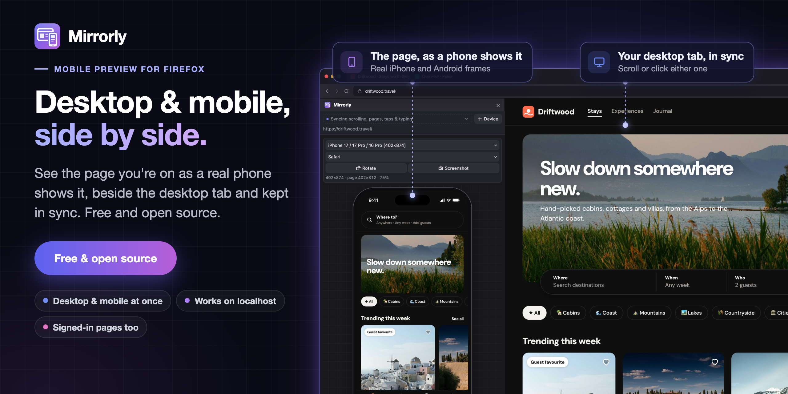
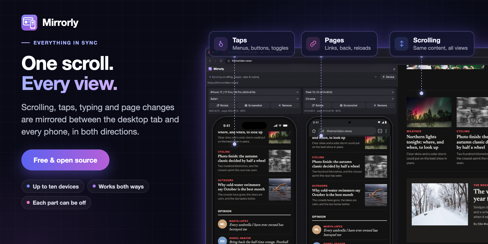
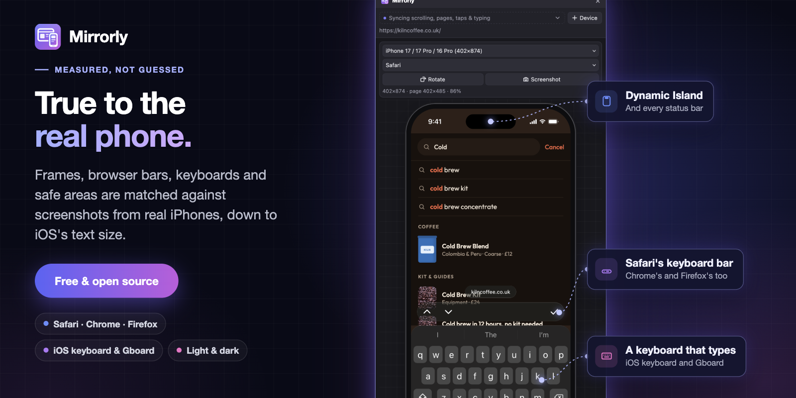

<a href="https://addons.mozilla.org/firefox/addon/mirrorly/"></a>

A free, open source Firefox extension that shows the page you're on as a phone
shows it, in Firefox's sidebar, right next to the desktop version. Real iPhone
and Android frames, with every scroll, tap and keystroke kept in sync between
the two.

Open the sidebar on any site and Mirrorly loads the same page in a phone.
Scroll the desktop and the phone follows; tap a menu in the phone and it opens
on the desktop too. It's for anyone who builds, tests or reviews websites and
wants the mobile layout in view without picking up a real phone every time.

> **No account, no server, no tracking. Mirrorly never sends your data anywhere.**

## Why not Responsive Design Mode?

Firefox's built-in Responsive Design Mode turns your tab into a blank
rectangle at a phone's width. Mirrorly does more:

- **It's more accurate.** Real device frames, browser bars, keyboards, safe
  areas and iOS's Text Size, measured from real phones, so you see what
  Safari's toolbar or the keyboard actually covers.
- **It keeps everything in sync.** Scrolling, taps, typing and page changes
  are mirrored between the desktop tab and the phone, both ways.
- **Desktop and mobile are on screen at once.** The desktop page stays as it
  is, with the phone beside it in the sidebar. Or several phones, say an
  iPhone next to a Pixel.

## Features

- **Everything in sync.** Scrolling lines up on the same content rather than
  the same percentage, so the phone shows the part of the page you're looking
  at, and carousels and scrollable panels follow too. Taps on buttons, menus
  and toggles are mirrored, text typed into a form
  appears in every view, and links, back/forward, reloads and tab switches carry
  across. It works in both directions, and each part can be turned off.
- **Up to ten devices at once.** **+ Device** adds another phone beside the
  others, say an iPhone next to a Pixel. They all follow the desktop tab, and
  each other. They're drawn at the same scale, so their sizes compare
  honestly, and when they don't all fit the row scrolls sideways.
- **Show in Mirrorly.** Right-click anything on the page and choose **Show in
  Mirrorly**: the sidebar opens if it's closed, and each phone scrolls to its
  copy and outlines it. If it's left out of the mobile layout, you're told.
- **Real phones.** iPhones from the SE to the 17 Pro Max, Pixel, Galaxy and
  Redmi, the iPad mini, or a custom size. Phones with identical screens share an
  entry (the 402×874 one covers the iPhone 17, 17 Pro and 16 Pro), so the list
  stays short.
- **Real browsers.** Each phone can be drawn in Safari (iOS 26's floating
  toolbar), Chrome, Firefox, or as a bare screen. The status bar, Dynamic Island
  or notch, home indicator and toolbars are measured from real iPhone
  screenshots, and each browser sends its own user agent.
- **A keyboard you can type on.** Tapping a text field slides up the iOS
  keyboard (Gboard on Android), with the bar each browser puts above it, and the
  page shrinks to fit as it does on the phone. Email and phone fields get their
  own layouts. Focusing a field in any view opens the keyboard in every phone.
- **Feels like a touch screen.** A fingertip replaces the pointer, you drag to
  scroll with momentum, and hover effects are switched off: `:hover` never
  applies, and `(hover)`/`(pointer)` media queries answer as a phone would.
  The page gets `touchstart`, `touchmove` and `touchend` events, pointer events
  say `pointerType: "touch"`, and a carousel that takes over a swipe stops the
  page scrolling, as it would on the phone.
- **Rotate and screenshot.** Turn any phone to landscape. **Screenshot** saves a
  PNG to `Downloads/Mirrorly/` at the phone's real resolution (1206×2622 for an
  iPhone 17 Pro screen): with the frame on a transparent background, just the
  page as it's shown, or the whole page from top to bottom.
- **Local and staging sites.** Pages on `localhost`, your network or a staging
  server work like any other, so you can check the mobile layout while you
  build it.
- **Matches your phone.** iOS's Text Size setting for sites that follow it,
  light and dark mode, and the screen size, pixel ratio and safe areas the
  phone would report. Pages without a mobile viewport tag are laid out at 980px
  and zoomed out, as iOS does.
- **Signed-in pages work.** The phones use your tabs' cookies, so dashboards,
  admin panels and anything else behind a login show up in the mobile view
  too, already signed in.



## How close is it to a real phone?

Checked against iPhone 17 Pro screenshots of Wikipedia, text wraps line for
line the same as on the phone, and Airbnb's bottom bar sits exactly where it
does above Safari's toolbar. The page is still drawn by Firefox's engine, not
Safari's WebKit or Chrome's Blink, so engine-specific CSS can differ, and
pinch-zoom isn't emulated.



## Install

From [Firefox Add-ons](https://addons.mozilla.org/firefox/addon/mirrorly/), or
from source:

1. Open `about:debugging#/runtime/this-firefox`.
2. **Load Temporary Add-on…** and pick `manifest.json` in this folder.

It stays loaded until Firefox restarts. `npm start` launches a fresh Firefox
profile with it installed.

Click the toolbar button, or press **Alt+Shift+M**, to open the sidebar, and
drag the sidebar's edge to make it wider. The line at the top says what's
being synced; click it for the settings.

## Development

```sh
npm install              # puppeteer and selenium-webdriver, for the scripts
npm run lint             # web-ext lint
npm run build            # dist/mirrorly-firefox-v<version>.zip, for AMO
npm run icons            # icons/icon.svg -> the PNG sizes
npm run store-assets     # capture + compose the store, social and docs images
```

`scripts/capture.js` runs the real extension in Firefox (headless, in dark
mode) against the made-up demo sites in `scripts/demo-sites/`, served locally,
and saves sidebar, desktop and phone captures to `scripts/output/`, with boxes
for the callouts.
`scripts/compose-slides.js` turns those into the 1280×800 store slides and the
2:1 social and docs images.

How it fits together:

- `sidebar/` holds one sandboxed iframe per device, loading the active tab's
  address. `chrome.js` draws the phone's status bar, toolbars and keyboard over
  it.
- `background.js` pairs each window's active tab with its sidebar and relays
  sync messages between them. For the phone views only, it strips
  `X-Frame-Options` and CSP `frame-ancestors`, and sets the phone's user agent.
  It also stops pages that reload themselves in a loop.
- `content.js` runs in the desktop tab and in each phone. It only reports real
  user input (`isTrusted`), so mirrored clicks and scrolls aren't echoed back.
- `styles.js` rewrites the phone views' stylesheets: hover off, and Safari's
  safe-area insets. `touch.js` adds the fingertip, drag-to-scroll and touch
  events.

## Limitations

- Firefox doesn't let extensions run on addons.mozilla.org and a few other
  Mozilla sites, so the phones show a message there.
- Some sites refuse to be framed, or redirect when they see a phone user agent.
  A page that reloads itself more than six times in three seconds is stopped.
- A tap or a scrolled box only mirrors when the other view has a matching
  visible element.
- Landscape toolbars and the light-mode keyboard are close estimates; portrait,
  dark-mode iPhone views are measured from real screenshots.

## Privacy

Mirrorly has no account, no analytics, no tracking and no server. Settings are
stored by Firefox on your computer. The only requests it causes are for the
page you're already viewing; the [privacy policy](https://dazecoop.github.io/mirrorly/privacy.html)
explains each one and every permission.

## Licence

MIT. See [LICENSE](LICENSE).
